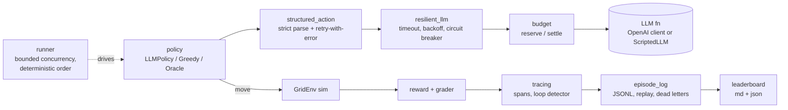

# warehouse-routing-openenv

An [OpenEnv](https://github.com/meta-pytorch/OpenEnv)-compliant gridworld
environment that trains and evaluates LLM agents on **multi-stop warehouse
routing**. An autonomous mobile robot (AMR) must visit every SKU location in a
warehouse and return to the packing station using the fewest moves possible.
Agents are graded against the optimal TSP solution for each variation.

Built to the [Meta PyTorch OpenEnv Hackathon](https://www.scaler.com/school-of-technology/meta-pytorch-hackathon/)
Round 1 spec as a learning / portfolio project.

## Motivation

Last-mile pick-and-pack is a well-studied operations research problem — TSP
with obstacles, a step budget, and a return-to-origin constraint. It is
small enough to admit optimal solutions (so grading is objective), large
enough to be non-trivial for an LLM prompted cold, and directly connected to
real AMR fleet planning. Three tiers (Easy / Medium / Hard) stress increasing
grid size, SKU count, obstacle density, and step budget.

## Task & grading

Each variation is a 2D grid containing:

- A **warehouse** cell (the packing station, always `(0, 0)`).
- A set of **SKU locations** (pick targets).
- A set of **obstacles** (blocked cells).
- A hard **step budget**.

The agent wins when every SKU has been visited **and** the robot is back at
the warehouse within the step budget. Score:

```
score = optimal_length / agent_length   (clamped to [0, 1])
score = 0                                (if not all SKUs visited or not returned)
```

Optimal length is computed with exact TSP (Held-Karp via `python-tsp`) over an
obstacle-aware Manhattan distance matrix built with A*.

### Tiers

| Tier   | Grid  | SKUs | Obstacle density | Step budget |
|--------|-------|------|------------------|-------------|
| Easy   | 8×8   | 3    | 0.00             | 64          |
| Medium | 16×16 | 6    | 0.10             | 200         |
| Hard   | 24×24 | 10   | 0.25             | 500         |

### Adaptive curriculum

`Curriculum` walks the agent Easy → Medium → Hard. A tier is **mastered** after
**3 consecutive variations scoring ≥ 0.9**, or **force-promoted** after 20
attempts. A default 19-minute wall-clock cap terminates the run under the
hackathon's 20-minute budget. Seeds are deterministic in
`(master_seed, tier_index, attempt)`.

## Action & observation space

### Action

```python
class Action(openenv.Action):
    move: Literal["N", "S", "E", "W"]
```

One grid cell per step, 4-connected. Pick-up and drop-off are automatic on
entering an SKU cell.

### Observation

```python
class Observation(openenv.Observation):
    grid_rows: int
    grid_cols: int
    warehouse: Cell
    sku_locations: list[Cell]
    obstacles: list[Cell]
    robot_pos: Cell
    visited: list[bool]          # parallel to sku_locations
    steps_taken: int
    step_budget: int
    tier: Literal["easy", "medium", "hard"]
    attempt: int
    variation_seed: int
    done: bool                   # inherited
    reward: float                # inherited, populated per step
    metadata: dict               # curriculum state, grader score, reward parts
```

### Reward

Dense shaped reward on every step:

| Event                 | Reward           |
|-----------------------|------------------|
| Any step (time cost)  | `-0.01`          |
| Invalid move          | `-0.05`          |
| Newly-visited SKU     | `+0.10`          |
| Terminal success      | `+optimal/agent` |
| Terminal failure      | `-0.20`          |

## Setup

Requires Python ≥ 3.12 (Docker is only needed for the container build).

```bash
git clone <this-repo>
cd warehouse-routing-openenv
uv sync                       # or: pip install -e ".[dev]"

# run the tests
uv run pytest                 # 198 tests, no API key needed

# smoke-test the environment offline (random policy, no LLM)
uv run python inference.py --dry-run --max-variations 5

# score the random / greedy / oracle baselines on every tier (no API key)
uv run python scripts/evaluate_baselines.py

# full evaluation platform run: policies + simulated-LLM failure scenarios, leaderboards, replayable logs
uv run python scripts/run_eval.py --seeds 10 --out-dir runs/latest

# validate the OpenEnv spec
uv run openenv validate .

# build & run the container
docker build -t warehouse-routing:dev .
docker run --rm -p 8000:8000 warehouse-routing:dev

# hit it
curl -X POST http://localhost:8000/reset -H 'content-type: application/json' -d '{}'
curl -X POST http://localhost:8000/step  -H 'content-type: application/json' -d '{"action":{"move":"E"}}'
```

## Running the LLM agent

Any OpenAI-compatible endpoint works. Defaults are Groq
(`https://api.groq.com/openai/v1`, `llama-3.3-70b-versatile`); the key is read
from `GROQ_API_KEY`, `HF_TOKEN` or `API_KEY`.

```bash
export API_BASE_URL="https://router.huggingface.co/v1"
export MODEL_NAME="Qwen/Qwen2.5-72B-Instruct"
export HF_TOKEN="hf_..."
python inference.py
```

`inference.py` logs each variation in the hackathon-mandated format:

```
[START] task=<tier-seedN-attemptM> env=warehouse_routing model=<model>
[STEP]  step=<n> action=<N|S|E|W> reward=<0.00> done=<bool> error=<msg|null>
[END]   success=<bool> steps=<n> score=<0.000> rewards=<r1,r2,...>
[SUMMARY] mean_score=<0.000> n=<N> mastered=<dict>
```

## Submission validator

Before submitting to HF Spaces, run:

```bash
./validate-submission.sh https://<your-space>.hf.space
```

Checks:

1. HF Space responds `200` to `POST /reset`
2. `docker build .` succeeds (10-min cap)
3. `openenv validate .` passes

## Baseline scores

See [`docs/baseline-scores.md`](docs/baseline-scores.md).

Offline policies, 20 seeded variations per tier (seeds 0–19), produced by
`uv run python scripts/evaluate_baselines.py`:

| Policy                     | Easy  | Medium | Hard  | Overall mean | Success rate |
|----------------------------|-------|--------|-------|--------------|--------------|
| Random                     | 0.000 | 0.000  | 0.000 | 0.000        | 0.00         |
| Greedy (nearest-neighbour) | 0.979 | 0.948  | 0.895 | 0.941        | 1.00         |
| Oracle (exact TSP)         | 1.000 | 1.000  | 1.000 | 1.000        | 1.00         |

LLM baseline pending API credentials.

## Meta-ecosystem fit

The environment is built on [OpenEnv](https://github.com/meta-pytorch/OpenEnv)
(`openenv-core`), Meta PyTorch's framework for agent environments: it exposes the
standard `reset` / `step` HTTP API and passes `openenv validate .`. Any
OpenAI-compatible model can be plugged in via `inference.py`.

## Evaluation platform architecture

Beyond the environment, the repo contains a small LLM-agent *evaluation platform*.
Everything below is implemented and tested offline (`uv run pytest`, no API key);
LLM behaviour is exercised with a **scripted mock LLM**, never a real model.



| Module (`src/warehouse_routing/`) | What it does | Tests |
|---|---|---|
| `structured_action.py` | Strict reply -> `Move` parsing (letter or `{"move": ..}`), up to `max_retries` re-asks that include the previous error, `LLMOutputError` after `max_retries+1` attempts, explicit `fallback_move` (wall-bump penalty step) | `test_structured_action.py` (21) |
| `resilient_llm.py` | Per-call timeout on a daemon thread (a hung call never blocks the caller), exponential backoff with injectable sleep/jitter, closed/open/half-open circuit breaker with injectable clock | `test_resilient_llm.py` (10) |
| `budget.py` | Thread-safe reserve-then-settle ledger; token/cost/step ceilings per episode and per run; per-model usage report; integer micro-dollar accounting | `test_budget.py` (13, incl. 200-thread test) |
| `tracing.py` | `Tracer` spans (finish order, parent names, errors), per-episode latency/cost/error accounting, repeated-state/prompt loop alerts at every multiple of a threshold, JSON report | `test_tracing.py` (13) |
| `episode_log.py` | JSONL episode log, deterministic replay that re-verifies positions/rewards/score, idempotent run IDs, dead-letter log with replay | `test_episode_log.py` (8) |
| `llm_policy.py`, `mock_llm.py` | `LLMPolicy` composing the above (shared prompt with `inference.py`), OpenAI client adapter, `ScriptedLLM`/`MockLLMPolicy` and seven failure scenarios | `test_llm_policy.py` (16) |
| `runner.py`, `leaderboard.py` | policy x tier x seed runner (bounded threads, results ordered by job index), retries + dead letters, deterministic leaderboard (Markdown + JSON); CLI in `scripts/run_eval.py` | `test_runner.py` (15) |
| `server/hardening.py`, `metrics.py` | Clean JSON errors, `GET /healthz`, `GET /metrics`, isolated per-client `/sessions` episodes | `test_server_hardening.py` (11) |

Design notes (details in each module docstring):

- **Timeouts** use a daemon thread + `Event.wait`, not `with ThreadPoolExecutor`
  (whose exit waits for the hung call).
- **Budget** is reserved *before* a call under one lock, so concurrent callers cannot
  collectively overspend; failed/timed-out calls are charged their full reservation.
- **Determinism**: the runner collects results by job index, per-episode state
  (RNG, breaker, logical clock) is never shared, and the leaderboard has no
  timestamps; `scripts/run_eval.py --workers 1` and `--workers 4` produced
  byte-identical leaderboard and budget files in our runs.

### Running the evaluation

```bash
uv run python scripts/run_eval.py --seeds 10 --workers 4 --out-dir runs/latest
```

Writes replayable `*-episodes.jsonl`, `*-dead-letters.jsonl`, `*-leaderboard.{md,json}`,
`*-trace.json` and `*-budget.json`; re-running skips episodes already logged.
Real numbers: [`docs/baseline-scores.md`](docs/baseline-scores.md).

### Server endpoints added

`GET /healthz`, `GET /metrics` (episodes started/completed/abandoned, active
episodes, mean score, steps), and an isolated-episode API:
`POST /sessions {"tier","seed"}`, `GET /sessions/{id}`,
`POST /sessions/{id}/step {"action":{"move":"E"}}`, `DELETE /sessions/{id}`.
Validation errors return `{"error": "validation_error", "detail": [...]}`;
`/step` before `/reset` returns 409 instead of a 500.

## What breaks in production / known limitations

- **No real-model results.** The LLM scenarios use a scripted fake model. The only
  real-LLM path (`python inference.py [--resilient]`) is untested against a live
  API in this repo; "LLM baseline pending API credentials".
- **Abandoned timeouts keep running.** Python cannot kill a thread; a timed-out call
  continues in the background (and may still be billed). The ledger keeps its
  reservation until it returns, so a call that never returns holds budget forever.
- **Token counts are estimates** (~4 chars/token) for reservations and in the mock;
  real providers differ. If a provider exceeds `max_tokens` the overshoot is
  recorded (`overshoots`) but cannot be prevented. Mock prices are illustrative.
- **Everything is in-memory / single process.** Sessions, metrics, breaker state and
  the tracer are lost on restart and not shared across workers or machines. The
  JSONL log is append-only on local disk with no cross-process locking.
- **Original OpenEnv `/reset` + `/step` still share one process-wide episode**
  (`SUPPORTS_CONCURRENT_SESSIONS = False`); use `/sessions` for isolation.
  `/sessions` has no authentication or rate limiting.
- **Tracer is capped** (50,000 spans by default); beyond that spans are counted but
  not stored (the `simulated-llm` run dropped 6,516 spans; summaries stay exact).
- **Simulated outage scenarios are small and synthetic**; the breaker uses a logical
  clock in the simulation, so real-time half-open behaviour is covered by unit tests
  only.
- **Environment scope**: single robot, single warehouse, 4-connected grid, three fixed
  tiers; the Greedy baseline already scores 0.94 mean, so the benchmark has little
  headroom except on Hard. Docker build and the HF Space were not verified on this box.
- **Strict parsing is stricter than `inference.py`'s default path**, which still
  accepts any reply containing N/S/E/W; use `--resilient` for the strict path.

## Repository layout

```
.
├── inference.py                 # hackathon entrypoint (OpenAI client)
├── openenv.yaml                 # OpenEnv spec
├── Dockerfile                   # multi-stage build on openenv-base
├── validate-submission.sh       # pre-submission gate
├── scripts/evaluate_baselines.py # offline baseline score table
├── server/app.py                # repo-root FastAPI entrypoint (re-exports)
├── src/warehouse_routing/
│   ├── models.py                # typed Observation / Action / Cell
│   ├── sim.py                   # GridEnv state machine
│   ├── tasks.py                 # TaskSpec, variation generator
│   ├── solver.py                # exact TSP + obstacle-aware distances
│   ├── pathing.py               # A* distance
│   ├── reward.py                # dense shaped reward
│   ├── grader.py                # 0..1 score
│   ├── policies.py              # Random / Greedy / Oracle baseline policies
│   ├── eval.py                  # evaluation harness (curriculum + per-tier)
│   ├── structured_action.py     # strict reply parsing + retry-with-error
│   ├── resilient_llm.py         # timeout / backoff / circuit breaker
│   ├── budget.py                # reserve/settle cost ledger
│   ├── tracing.py               # spans, episode accounting, loop detector
│   ├── episode_log.py           # JSONL log, replay, dead letters
│   ├── llm_policy.py            # LLMPolicy + OpenAI adapter
│   ├── mock_llm.py              # scripted fake LLM + scenarios
│   ├── runner.py                # policy x tier x seed runner
│   ├── leaderboard.py           # markdown/json leaderboard
│   ├── metrics.py               # server counters
│   ├── curriculum.py            # adaptive Easy→Medium→Hard state machine
│   ├── env.py                   # OpenEnv Environment adapter
│   └── server/                  # app.py (FastAPI), hardening.py, ui.py
├── scripts/run_eval.py          # full offline evaluation + leaderboards
├── tests/                       # 198 tests
└── docs/                        # plans, ADRs, baseline scores
```

## License

MIT
